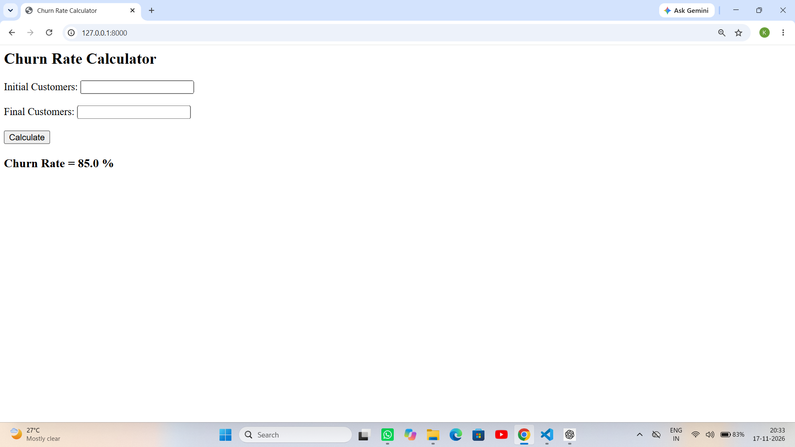

# Ex.03 Design a Website for Server Side Processing
## Date:13/11/2026

## AIM:
To create a web page to calculate Churn Rate using server-side scripts.

## FORMULA:
Churn Rate = (CustLost / InitCust) * 100
<br> InitCust --> Initial Customers Count
<br> CustLost --> Customers Lost Count

## DESIGN STEPS:

### Step 1:
Clone the repository from GitHub.

### Step 2:
Create Django Admin project.

### Step 3:
Create a New App under the Django Admin project.

### Step 4:
Create a HTML file to implement form based input and output.

### Step 5:
Create python programs for views and urls to perform server side processing.

### Step 6:
Receive input values from the form using request.POST.get().

### Step 7:
Calculate the Result using the given formula.

### Step 8:
Display the calculated result in the server console.

### Step 9:
Render the result to the HTML template.

### Step 10:
Publish the website in Localhost.

## PROGRAM:
```
<html>
<head>
    <title>Churn Rate Calculator</title>
</head>
<body>

    <h2>Churn Rate Calculator</h2>

    <form method="POST">
        

        Initial Customers:
        <input type="number" name="initial" required>
        <br><br>

        Final Customers:
        <input type="number" name="final" required>
        <br><br>

        <input type="submit" value="Calculate">
    </form>

    <h3>Churn Rate = {{ churn }} %</h3>

</body>
</html>

views.py

from django.shortcuts import render

def churn_rate(request):
    i = float(request.POST.get('initial', '0'))
    f = float(request.POST.get('final', '0'))

    churn = ((i - f) / i * 100) if request.method == 'POST' and i != 0 else 0

    print("initial customers =", i)
    print("final customers =", f)
    print("churn rate =", churn)

    return render(request, 'myapp/karthi.html',
                  {'i': i, 'f': f, 'churn': churn})


urls.py

    from django.contrib import admin
from django.urls import path
from myapp import views

urlpatterns = [
    path('', views.churn_rate, name='churn_rate'),
]
```

## OUTPUT - SERVER SIDE:
.png>)

## OUTPUT - WEBPAGE:


## RESULT:
The the web page to calculate Churn Rate using server-side scripts is created successfully.
